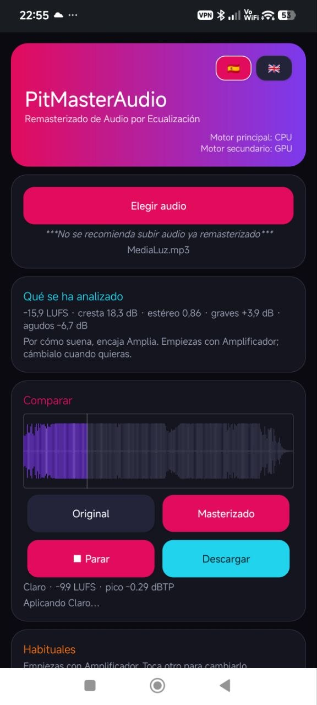
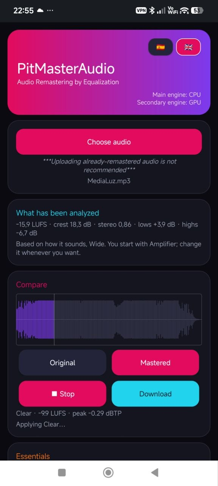
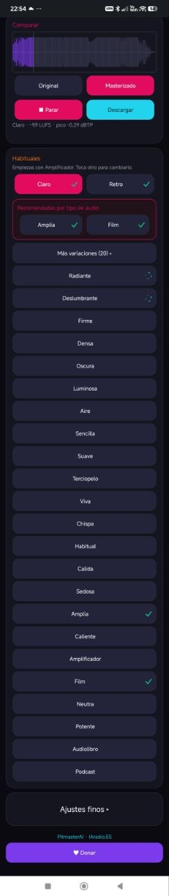
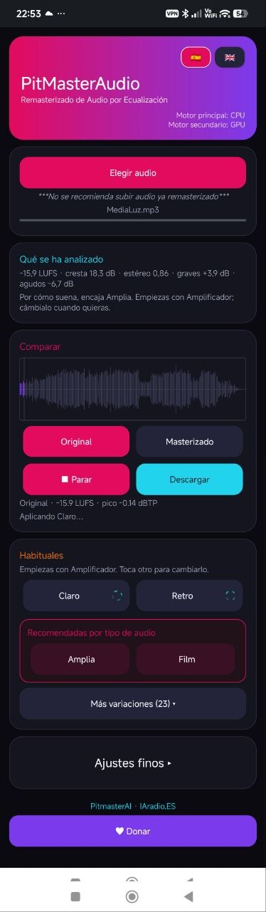
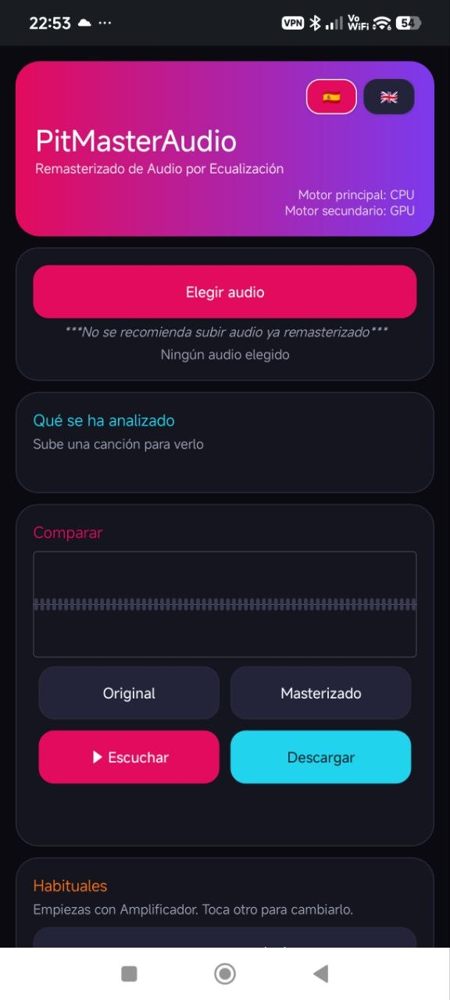

# PitMasterAudio

**Masterizado de audio por ecualización · Audio remastering by equalization**

<p align="center">
  
  
</p>

[Español](#español) · [English](#english)

---

## Español

PitMasterAudio es una aplicación de masterizado de audio que funciona **entera en tu
ordenador o en tu móvil**. Le das una canción y te devuelve la misma canción con el
sonido equilibrado, más fuerte y más limpia, sin subirla a ningún servidor y sin
crear ninguna cuenta.

El motor principal va en **CPU** y el secundario en **GPU**, así que una pista de
3 a 7 minutos tarda segundos, no minutos.

| | |
|---|---|
| **Versión** | 1.0 |
| **Plataformas** | Linux (deb, AppImage) · Windows 10/11 (instalador, portable, ZIP) · Android 7+ (APK, AAB) |
| **Idiomas** | Español e inglés (detecta el idioma la primera vez y lo recuerda) |
| **Dependencias** | Ninguna cuenta, ninguna nube, ninguna suscripción |

<p align="center">
  
  
  
</p>

### Qué hace exactamente

1. **Elige el audio.** WAV, FLAC, AIFF, OGG, MP3 o M4A/AAC. No hace falta que sea
   un WAV sin comprimir: si viene comprimido, se decodifica antes de procesarlo y, al
   descargar, se te devuelve **en el mismo formato, calidad y con las mismas
   etiquetas y portada** que tenía el original.
2. **Analiza la canción.** Mide sonoridad (LUFS), factor de cresta, imagen estéreo
   (correlación L/R) y el balance de graves y agudos, y te lo enseña en claro:
   «−15,9 LUFS · cresta 18,3 dB · estéreo 0,86 · graves +3,9 dB · agudos −6,7 dB»,
   con una frase que dice cómo suena y por qué ajuste empezar.
3. **Aplica un ajuste.** Hay 25 ajustes propios (8 de base, 15 variaciones de
   intensidad y color, y 2 para voz). Puedes escuchar el original y el masterizado
   cambiando entre ellos sin que se corte el sonido, y descargar el resultado cuando
   te guste.
4. **Ajuste fino.** Si quieres, mueves la sonoridad objetivo, la intensidad o el
   techo de picos y ves el efecto al momento.

### Cómo funciona por dentro

La cadena de procesado es siempre la misma, en este orden:

1. **Filtro paso alto** variable (solo en los ajustes que recortan graves).
2. **Ecualización tonal de 30 bandas** de 1/3 de octava, implementada como cascada de
   biquads peaking y shelf (RBJ) en una sola pasada.
3. **Compresión multibanda** con corte en 250 Hz y 3 kHz; umbral, ratio, ataque y
   release salen de la dinámica que se ha medido antes por bandas.
4. **Saturación** `tanh` con armónicos pares opcionales y filtro de tono.
5. **Imagen estéreo** por ganancia de la señal lateral, más reverb en los ajustes
   ambientales.
6. **Normalización de sonoridad** a los LUFS de cada ajuste, con **limitador de pico
   real** de 4× sobremuestreo y lookahead, techo a −0,3 dBFS.

Las curvas de cada ajuste no son inventadas: se midieron comparando pares de audio
(original y masterizado de referencia) y se afinaron con un bucle de calibración que
resta la diferencia espectral de la curva, iteración a iteración. La anchura estéreo
se resuelve analíticamente para igualar la correlación L/R, y el factor de cresta
ajustando el ratio de compresión. El error tonal medido queda por debajo de 0,5 dB.

El trabajo pesado se reparte por trozos de audio entre hilos (hasta núcleos−1, con
tope de 12) y, si hay tarjeta gráfica, la GPU se encarga de la parte vectorial con
**shaders propios de Vulkan compute** (con reserva a CUDA/torch y, si no hay nada,
CPU). Todo el proceso se hace en memoria y con un solo trabajador por motor: se
comprobó que dos cadenas a la vez van más lentas que una sola.

En Android no hay Python ni servidor: el motor está **reescrito en Java nativo**
(`android/app/src/es/pitmasterai/masterlab/motor/`), con la parte de GPU por NDK y
Vulkan, para que funcione sin conexión y sin gastar batería en un servicio web.

### Instalación

**Linux**

```bash
# Debian/Ubuntu/Pop!_OS
sudo apt install ./pitmasteraudio_1.0_all.deb

# o sin instalar nada
chmod +x PitMasterAudio-x86_64.AppImage && ./PitMasterAudio-x86_64.AppImage
```

Abre el panel en `http://127.0.0.1:5077`.

**Windows**

- `PitMasterAudio-1.0-Setup.exe` — instalador normal.
- `PitMasterAudio-1.0-Portable.exe` — un solo fichero, no instala nada (se
  descomprime en `%LOCALAPPDATA%`).
- `PitMasterAudio-1.0-Windows-portable.zip` — la carpeta suelta, con el `.exe`
  dentro.

La ventana es propia (WebView2), sin barra de direcciones. Al cerrarla se cierra
todo, incluido el proceso de sonido.

**Android**

Instala `PitMasterAudio-1.0.apk` (para probar a mano). El `.aab` es para Google Play.

### Privacidad

El audio **nunca sale del dispositivo**. No hay servidor, ni cuenta, ni telemetría:
el panel escucha solo en `127.0.0.1` y la app de Android trabaja con ficheros locales.

### Estructura del repositorio

```
dsp.py, motor.py, paralelo.py, gpuops.py, vk_compute.py, aceleracion.py, presets.json
    Motor de escritorio: DSP, cadena de ajustes, reparto de hilos y GPU.
vk/                 Shaders de Vulkan compute.
app/                Panel local (Flask + HTML/JS) y motor de sonido propio (portaudio).
android/            App Android nativa (Java + NDK).
empaquetado/        Scripts de compilación: deb, AppImage, Windows, portable, APK, AAB.
docs/               Arquitectura y notas técnicas.
capturas/           Capturas de la aplicación.
```

### Compilar desde el código

```bash
# Motor de escritorio (necesita numpy, scipy, soundfile, flask, pyloudnorm)
python motor.py cancion.wav -p base_equilibrado

# Paquetes (Linux)
python3 empaquetado/build_deb.py
bash    empaquetado/build_appimage.sh

# Paquetes (Windows, desde Linux con mingw + NSIS)
python3 empaquetado/build_windows.py
python3 empaquetado/build_portable.py

# Android (aapt2 + javac + d8 + apksigner, sin Gradle)
python3 empaquetado/build_apk.py
python3 empaquetado/build_aab.py
```

### Licencia

Código disponible para consulta, estudio y verificación. Todos los derechos
reservados; ver [LICENSE](LICENSE).

---

## English

PitMasterAudio is an audio mastering application that runs **entirely on your own
computer or phone**. You give it a song and it hands back the same song with a more
balanced, louder and cleaner sound — without uploading it anywhere and without
creating an account.

The main engine runs on the **CPU** and the secondary one on the **GPU**, so a 3-to-7
minute track takes seconds, not minutes.

| | |
|---|---|
| **Version** | 1.0 |
| **Platforms** | Linux (deb, AppImage) · Windows 10/11 (installer, portable, ZIP) · Android 7+ (APK, AAB) |
| **Languages** | Spanish and English (detected on first run, then remembered) |
| **Requirements** | No account, no cloud, no subscription |

### What it actually does

1. **Pick your audio.** WAV, FLAC, AIFF, OGG, MP3 or M4A/AAC. It does not have to be
   an uncompressed WAV: compressed files are decoded before processing and, when you
   download, you get the result **in the same format and quality, keeping the original
   tags and cover art**.
2. **It analyses the song.** It measures loudness (LUFS), crest factor, stereo image
   (L/R correlation) and the low/high balance, and shows it in plain words:
   "−15.9 LUFS · crest 18.3 dB · stereo 0.86 · lows +3.9 dB · highs −6.7 dB",
   plus a sentence saying how it sounds and which preset to start with.
3. **It applies a preset.** There are 25 built-in presets (8 base, 15 intensity/colour
   variations and 2 for voice). You can A/B the original against the mastered version
   with no gap in the sound, and download whenever you like it.
4. **Fine tuning.** If you want, you can move the target loudness, the intensity or the
   peak ceiling and hear the result instantly.

### How it works inside

The processing chain is always the same, in this order:

1. Variable **high-pass filter** (only on presets that trim the lows).
2. **30-band tonal EQ** at 1/3 octave, built as a cascade of RBJ peaking and shelf
   biquads in a single pass.
3. **Multiband compression** split at 250 Hz and 3 kHz; threshold, ratio, attack and
   release are derived from the per-band dynamics measured beforehand.
4. **Saturation** with `tanh`, optional even harmonics and a tone filter.
5. **Stereo image** through side-signal gain, plus reverb on the ambient presets.
6. **Loudness normalisation** to each preset's LUFS target, with a **true-peak limiter**
   using 4× oversampling and lookahead, ceiling at −0.3 dBFS.

The curves behind each preset are not made up: they were measured by comparing audio
pairs (original and reference master) and refined with a calibration loop that subtracts
the spectral difference from the curve, iteration after iteration. Stereo width is
solved analytically to match L/R correlation, and crest factor by adjusting the
compression ratio. Measured tonal error stays below 0.5 dB.

The heavy lifting is split across threads in audio chunks (up to cores−1, capped at 12)
and, when a graphics card is present, the GPU handles the vector part with **custom
Vulkan compute shaders** (falling back to CUDA/torch and then to CPU). Everything runs
in memory with a single worker per engine: two concurrent chains measured slower than
one.

On Android there is no Python and no server: the engine is **rewritten in native Java**
(`android/app/src/es/pitmasterai/masterlab/motor/`), with the GPU part through NDK and
Vulkan, so it works offline and does not drain the battery on a web service.

### Install

**Linux**

```bash
sudo apt install ./pitmasteraudio_1.0_all.deb
# or run it without installing
chmod +x PitMasterAudio-x86_64.AppImage && ./PitMasterAudio-x86_64.AppImage
```

The panel opens at `http://127.0.0.1:5077`.

**Windows**

- `PitMasterAudio-1.0-Setup.exe` — regular installer.
- `PitMasterAudio-1.0-Portable.exe` — single file, nothing installed (it unpacks to
  `%LOCALAPPDATA%`).
- `PitMasterAudio-1.0-Windows-portable.zip` — the plain folder with the `.exe` inside.

The window is its own (WebView2), with no address bar. Closing it shuts everything
down, including the audio process.

**Android**

Install `PitMasterAudio-1.0.apk` (for manual testing). The `.aab` is for Google Play.

### Privacy

Audio **never leaves the device**. There is no server, no account and no telemetry: the
panel only listens on `127.0.0.1` and the Android app works with local files.

### Repository layout

```
dsp.py, motor.py, paralelo.py, gpuops.py, vk_compute.py, aceleracion.py, presets.json
    Desktop engine: DSP, preset chain, thread and GPU dispatch.
vk/                 Vulkan compute shaders.
app/                Local panel (Flask + HTML/JS) and its own sound engine (portaudio).
android/            Native Android app (Java + NDK).
empaquetado/        Build scripts: deb, AppImage, Windows, portable, APK, AAB.
docs/               Architecture and technical notes.
capturas/           Application screenshots.
```

### Build from source

```bash
# Desktop engine (needs numpy, scipy, soundfile, flask, pyloudnorm)
python motor.py song.wav -p base_equilibrado

# Linux packages
python3 empaquetado/build_deb.py
bash    empaquetado/build_appimage.sh

# Windows packages (from Linux, with mingw + NSIS)
python3 empaquetado/build_windows.py
python3 empaquetado/build_portable.py

# Android (aapt2 + javac + d8 + apksigner, no Gradle)
python3 empaquetado/build_apk.py
python3 empaquetado/build_aab.py
```

### License

Source available for reading, study and verification. All rights reserved; see
[LICENSE](LICENSE).

---

Hecho por [PitmasterAI](https://www.pitmasterai.es) · Made by [PitmasterAI](https://www.pitmasterai.es)
